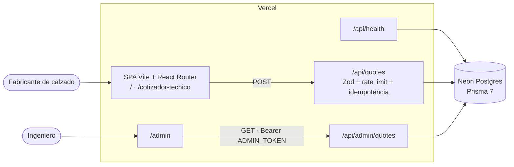

# LACERS CNC — Matricería CNC con Cotizador Técnico

[](https://github.com/Pitix24/lacers_landing_page/actions/workflows/ci-cd.yml)


> Landing de matricería CNC en aluminio (7075-T6 / 6061) para moldes de inyección de calzado, con
> un **Cotizador Técnico** que registra cada solicitud y un **panel `/admin`** para el ingeniero.

## Resumen ejecutivo

**Problema:** LACERS cotizaba matrices de aluminio para calzado a mano, por WhatsApp y llamadas,
con el filtro técnico concentrado en un solo ingeniero. Las consultas llegaban incompletas (sin
aleación, sin polímero, sin curva de tallas) y obligaban a varias idas y vueltas. El Cotizador
Técnico guía al fabricante de calzado por un wizard que valida esos datos, calcula una estimación
preliminar y guarda la solicitud en Postgres con un código de seguimiento; el ingeniero las lee en
`/admin`. Detalle en el [PRD](docs/01-producto/PRD.md).

**Aprendizajes:** *pendiente — a completar por el equipo.*

## Demo

- **Link:** *pendiente* (se publica en la variable `PRODUCTION_URL` al habilitar el pipeline).
- **Video (~3 min):** *pendiente.*

## Quickstart

Requisito: Node 22+. No hace falta base de datos para probarlo: sin `DATABASE_URL`, la API guarda
las cotizaciones **en memoria** (solo en local; en Vercel responde 503).

```bash
npm install                    # 1. Install (también corre prisma generate)
cp .env.example .env.local     # 2. Config (opcional: dejarlo vacío = API en memoria)
npm run dev                    # 3. Run → http://localhost:5173
```

Para usar Neon, completar `.env.local` con la **rama `dev`** (nunca `production`) y correr
`npm run db:migrate` y `npm run db:seed`.

| Variable | Para qué | Requerida |
|---|---|---|
| `DATABASE_URL` | Conexión *pooled* de Neon (runtime de la API) | No en local · Sí en Vercel |
| `DATABASE_URL_UNPOOLED` | Conexión directa, solo para el CLI de Prisma (migraciones) | Para migrar |
| `ADMIN_TOKEN` | Token Bearer de `GET /api/admin/quotes` (mínimo 24 caracteres) | Para `/admin` |
| `IP_HASH_SALT` | Sal del hash de IP del rate limit (la IP nunca se guarda en claro) | Recomendada |

Otros comandos: `npm run build` (Prisma + tipos SPA/API + Vite), `npm run lint` (solo tipos),
`npx playwright test` (E2E en Chromium, API en memoria — ver [testing](docs/07-testing/README.md)).

## Arquitectura



| Capa | Tecnología |
|---|---|
| Frontend | Vite 5, React 18, TypeScript (strict), React Router 7, Tailwind CSS 3 |
| Backend | Vercel Functions (`api/`, firma Web `Request → Response`), lógica en `server/`, Zod 4 compartido con el wizard (`src/lib/cotizador/`) |
| Datos | PostgreSQL en Neon, Prisma 7 + `@prisma/adapter-neon` |
| Infra / CI | Vercel + GitHub Actions (build → E2E → deploy → smoke) |
| Tests | Playwright (Chromium) |

## Decisiones clave

- [ADR-0001](docs/03-arquitectura/adrs/0001-despliegue-vercel-free-tier.md) — Despliegue en Vercel (free tier): SPA estática + Functions en Node.js.
- [ADR-0002](docs/03-arquitectura/adrs/0002-persistencia-neon-postgresql.md) — PostgreSQL en Neon con ramas `dev` y `production`.
- [ADR-0003](docs/03-arquitectura/adrs/0003-componentes-monorepo-spa-y-functions.md) — Un repo, un deploy: SPA + Vercel Functions.
- [ADR-0005](docs/03-arquitectura/adrs/0005-modelo-de-datos-cotizaciones.md) — Modelo de datos: cotizaciones y rate limit; catálogo en código.
- [ADR-0006](docs/03-arquitectura/adrs/0006-api-rest.md) — API REST + JSON sobre `/api`, una Function por recurso.
- [ADR-0007](docs/03-arquitectura/adrs/0007-validacion-server-side-y-calculo-compartido.md) — Validación server-side con un esquema Zod compartido.
- [ADR-0009](docs/03-arquitectura/adrs/0009-idempotencia-en-cotizaciones.md) — Idempotencia del envío por `submission_key`.
- [ADR-0010](docs/03-arquitectura/adrs/0010-proteccion-anti-spam-rate-limit.md) — Anti-spam: rate limit atómico en Postgres.
- [ADR-0013](docs/03-arquitectura/adrs/0013-datos-personales-y-retencion.md) — Datos personales: aviso, retención y anonimización.
- [ADR-0014](docs/03-arquitectura/adrs/0014-acceso-a-datos-prisma-neon.md) — Prisma 7 sobre Neon (reemplaza a ADR-0004, Drizzle).

Las 14 ADRs, incluidas las de auth del admin (0008, 0012, aún no implementadas: hoy `/admin` usa
`ADMIN_TOKEN`), están en [`docs/03-arquitectura/adrs/`](docs/03-arquitectura/adrs/).

## Mapa de artefactos AI-First

Cada paso consume el anterior. Índice completo y trazabilidad de un requisito de punta a punta en
[`docs/README.md`](docs/README.md).

| # | Paso | Artefacto | Skill / agente |
|---|---|---|---|
| 01 | Producto | [`PRD.md`](docs/01-producto/PRD.md) | `generar-prd-conversacional` |
| 02 | Diseño | [`DESIGN.md`](docs/02-diseno/DESIGN.md) | Stitch → tokens Tailwind |
| 03 | Arquitectura | [`TECH-DESIGN.md`](docs/03-arquitectura/TECH-DESIGN.md) + [14 ADRs](docs/03-arquitectura/adrs/) + [revisión adversarial](docs/03-arquitectura/REVISION-ADVERSARIAL-v1.md) | `generar-tech-design`, `revision-adversarial` |
| 04 | Backlog | [`BACKLOG.md`](docs/04-backlog/BACKLOG.md) | `generar-backlog` |
| 05 | Specs | [`openspec/changes/`](openspec/changes/) ([estado](docs/05-specs/README.md)) | OpenSpec + subagente `spec-implementer` |
| 06 | Diagramas | [`docs/06-diagramas/`](docs/06-diagramas/) | `mermaid-diagrams`, `archify` |
| 07 | Testing | [`tests/`](tests/) ([qué cubren](docs/07-testing/README.md)) | `playwright-e2e-test` |
| 08 | Seguridad | [`SECURITY-REPORT.md`](docs/08-seguridad/SECURITY-REPORT.md) | `security-pass` |
| 09 | Deploy | [Deploy Plan](docs/09-deploy/README.md) + [`ci-cd.yml`](.github/workflows/ci-cd.yml) | `deploy-pass` |
| — | Portada | `README.md` (este archivo) | `generar-readme` |

Contexto y reglas para el agente: [`CLAUDE.md`](CLAUDE.md). Subagentes (`code-reviewer`,
`spec-implementer`), skills y hooks del proyecto: [`.claude/`](.claude/). Skill propia del dominio:
[`agregar-aleacion-cnc`](.claude/skills/agregar-aleacion-cnc/).

## Deploy

`main` es el único camino a producción. GitHub Actions corre **1)** build + validación del esquema
Prisma y de tipos, **2)** los E2E de Playwright en Chromium, y solo si ambos pasan **3)** dispara
el deploy en Vercel (Deploy Hook o CLI) y **4)** un smoke test de solo lectura sobre la URL pública
(`/`, `/cotizador-tecnico`, `/admin`, `/api/health` → 200). El deploy por Git de Vercel está
desactivado en `vercel.json`. Las migraciones **no** corren en el pipeline: se aplican a mano con
`npm run db:migrate` antes de mergear un cambio de esquema. Secrets, entornos y recovery en el
[Deploy Plan](docs/09-deploy/README.md).

## Estructura del repo

```text
api/                 Vercel Functions: health, quotes, admin/quotes
server/              HTTP helpers, cliente Prisma/Neon, repositorio, rate limit
prisma/              schema, migraciones y seed
src/
├── pages/           Home, CotizadorTecnicoPage, AdminPage (lazy)
├── components/      Secciones de la landing + wizard CotizadorTecnico.tsx
├── lib/cotizador/   Contrato de API, esquema Zod y cálculo compartidos con el servidor
├── data/            landingData.ts — todo el contenido y catálogo (CNC_ALLOYS, CNC_PROCESSES…)
└── types/           Tipos del contenido
tests/               E2E Playwright
docs/                Pipeline documental 01 → 09
```

## Design System

Tokens semánticos en `tailwind.config.js` (detalle en [`DESIGN.md`](docs/02-diseno/DESIGN.md)):
`canvas`, `surface-card`, `metal`, `accent-red`, `accent-green`, `main`, `muted`. Tipografía Space
Grotesk (titulares), Inter (cuerpo) y JetBrains Mono (métricas/HUD). Radios `rounded-sm` (corte
recto mecanizado). Copy en español rioplatense; tags técnicos con prefijo `//`.
