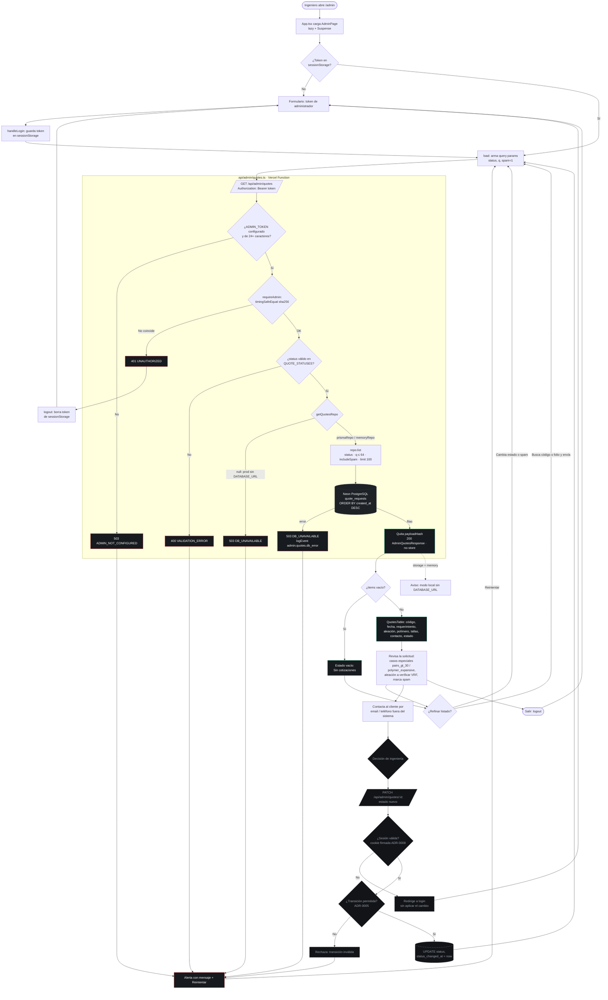
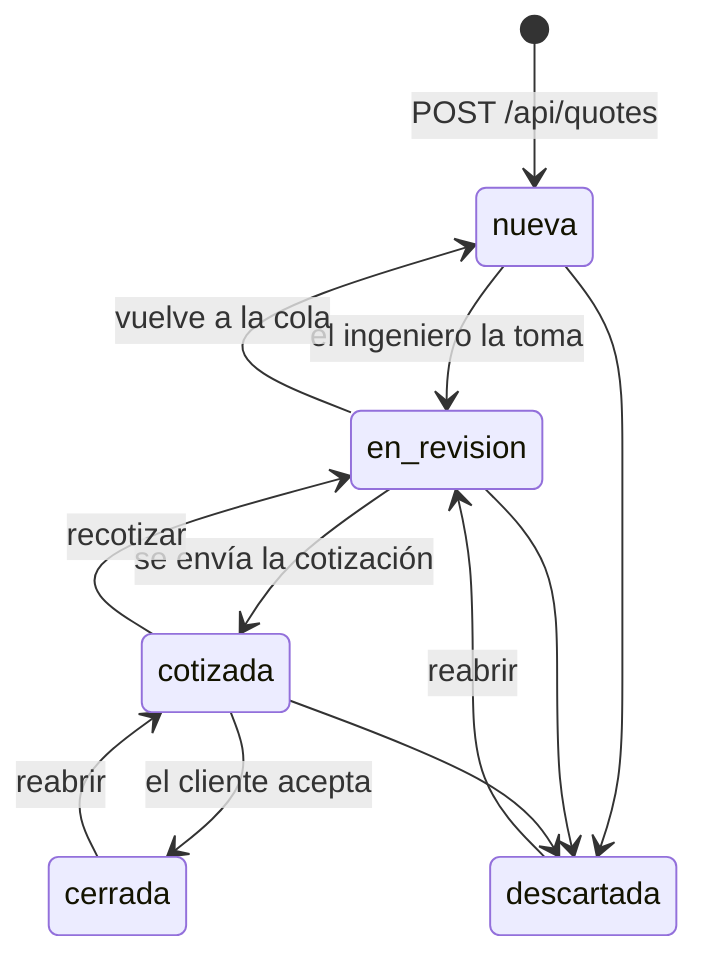

# Flujo — Revisión administrativa de cotizaciones (v1)

> Recorrido del ingeniero/administrador en `/admin`: acceso, listado y filtrado de solicitudes,
> y ciclo de estados. Derivado de `src/pages/AdminPage.tsx`, `api/admin/quotes.ts`,
> `server/http.ts` y `server/quotes-repo.ts`.
>
> **Leyenda:** nodos con borde sólido = implementado hoy; nodos punteados = pendiente de
> **spec-04** (login con cookie firmada de ADR-0008, `PATCH` de estado y paginación por cursor).

## Grafo de componentes y llamadas

| Capa | Archivo | Responsabilidad |
| --- | --- | --- |
| SPA | `src/App.tsx` | Ruta `/admin` con `lazy()` + `Suspense` (chunk aparte de la landing). |
| SPA | `src/pages/AdminPage.tsx` | Login provisorio por token en `sessionStorage`, filtros (`status`, `q`, `spam`), tabla y estados vacío/error. |
| Function | `api/admin/quotes.ts` | `GET /api/admin/quotes`: `requireAdmin`, valida `status` contra `QUOTE_STATUSES`, `q` truncado a 64, límite 100. Quita `payloadHash` de la respuesta. |
| Servidor | `server/http.ts` | `requireAdmin()`: `Authorization: Bearer <ADMIN_TOKEN>` comparado con `timingSafeEqual` sobre sha256. |
| Servidor | `server/quotes-repo.ts` | `list()`: filtro por estado, oculta spam por defecto, busca por `publicCode` o `folio`, orden `createdAt desc`. |
| Datos | `prisma/schema.prisma` | Índice `(status, createdAt desc)` sobre `quote_requests`. |

## Diagrama de flujo

## Ciclo de estados de una solicitud

Transiciones permitidas según ADR-0005 (validación en servidor pendiente de spec-04). Toda
solicitud nace en `nueva` desde `POST /api/quotes`.

## Notas

- **Auth provisoria:** hoy el panel usa `ADMIN_TOKEN` como Bearer guardado en `sessionStorage`;
  un `401` hace logout automático. La spec-04 lo reemplaza por login + cookie `httpOnly` firmada
  (ADR-0008, ADR-0012).
- **Datos personales (ADR-0013):** el contacto solo viaja en `/api/admin/*`; `logEvent` nunca
  registra nombre, email ni teléfono.
- **Spam:** las solicitudes con honeypot se ocultan salvo con el filtro "Incluir spam"
  (`spam=1`).
- **Fuera de alcance del MVP (PRD):** notificaciones automáticas al cambiar de estado, roles
  múltiples y auditoría de quién cambió cada estado.
