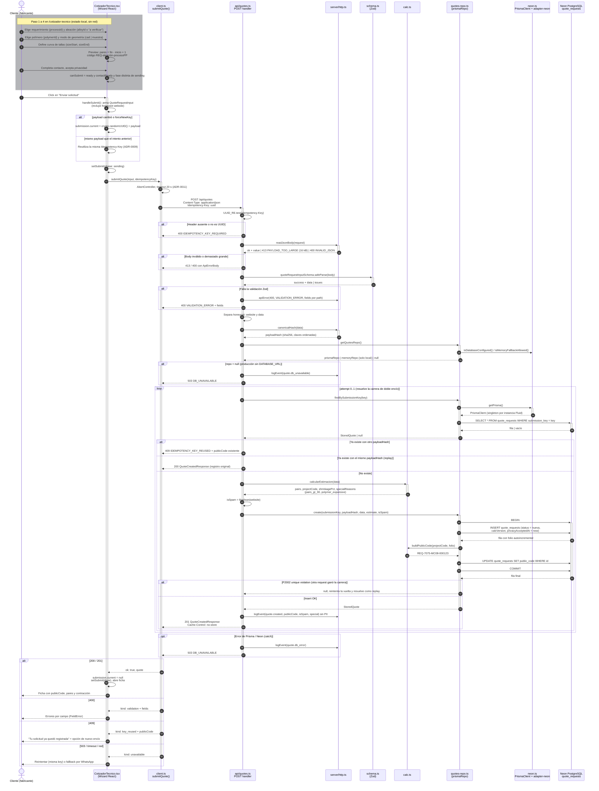

# Secuencia — Cotización Técnica CNC (v1)

> Flujo completo de una solicitud del Cotizador Técnico, desde el wizard en `/cotizador-tecnico`
> hasta la validación y persistencia en Neon PostgreSQL. Derivado del código actual (no del
> diseño objetivo): lo pendiente de specs futuras se marca como tal.
>
> Versión visualizable en navegador: [cotizacion-secuencia-v1.html](cotizacion-secuencia-v1.html).

## Grafo de componentes y llamadas

| Capa | Archivo | Responsabilidad en el flujo |
| --- | --- | --- |
| SPA | `src/components/CotizadorTecnico.tsx` | Estado del wizard (4 pasos), arma `QuoteRequestInput`, genera y reutiliza la `Idempotency-Key` (`crypto.randomUUID()`), muestra ficha o errores. |
| SPA | `src/lib/cotizador/client.ts` | `submitQuote()`: `fetch POST /api/quotes` con timeout de 20 s (ADR-0011) y mapeo a `SubmitQuoteResult` (`validation` / `key_reused` / `unavailable`). |
| Function | `api/quotes.ts` | Handler `POST`: header de idempotencia, body, Zod, deduplicación, cálculo y alta (ADR-0006, ADR-0009). |
| Servidor | `server/http.ts` | `readJsonBody` (límite 16 kB), `canonicalHash` (sha256 con claves ordenadas), `apiError`, `json`, `logEvent` sin PII. |
| Compartido | `src/lib/cotizador/schema.ts` | `quoteRequestInputSchema` (Zod): catálogo, tallas 15–50, contacto, privacidad, honeypot `website` (ADR-0007, ADR-0010). |
| Compartido | `src/lib/cotizador/calc.ts` | `calcularEstimacion()` (pares, `projectCode`, contracción, casos especiales) y `buildPublicCode()`. El servidor siempre recalcula. |
| Servidor | `server/quotes-repo.ts` | `getQuotesRepo()` → repo Prisma (Neon) o memoria (solo local sin `DATABASE_URL`); `findBySubmissionKey`, `create`. |
| Servidor | `server/neon.ts` | `getPrisma()`: `PrismaClient` + `@prisma/adapter-neon`, instancia única por proceso (ADR-0014). |
| Datos | `prisma/schema.prisma` | Tabla `quote_requests`: `submission_key` y `public_code` únicos, `folio` autoincremental. |

## Diagrama de secuencia

## Notas

- **El cliente no es fuente de verdad:** `pairs`, `projectCode`, `shrinkagePct` y
  `specialReasons` los recalcula el servidor con `calcularEstimacion()`; el wizard solo los usa
  como preview.
- **Honeypot (ADR-0010):** si `website` viene con valor, la solicitud se guarda igual con
  `isSpam = true` (respuesta 201 indistinguible) y queda oculta en el listado admin por defecto.
- **Idempotencia (ADR-0009):** la misma key con el mismo payload devuelve `200` con el registro
  original; con otro payload, `409`. La carrera entre dos inserts se resuelve por la restricción
  única de `submission_key` (`P2002`) y una segunda vuelta del loop.
- **Fallback en memoria:** sin `DATABASE_URL`, en local/test `getQuotesRepo()` devuelve
  `memoryRepo` (`storage: 'memory'`); en Vercel responde `503`.
- **Pendiente (spec-02):** rate limit por IP (ADR-0010) y cron de retención/anonimización
  (ADR-0013) todavía no están en el flujo.
