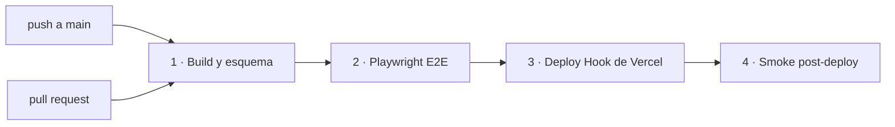
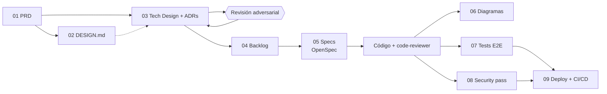

# Documentación — LACERS CNC

Punto de entrada a la documentación del proyecto: qué es, cómo se despliega, qué decisiones
técnicas se tomaron y cómo está organizado el repo para desarrollar con Claude Code. La portada
pública (quickstart, badges, stack) es el [`README.md`](../README.md) de la raíz.

- [1. El proyecto](#1-el-proyecto)
- [2. Despliegue](#2-despliegue)
- [3. Decisiones técnicas](#3-decisiones-técnicas)
- [4. Desarrollo con Claude Code](#4-desarrollo-con-claude-code)
- [5. Pipeline documental (01 → 09)](#5-pipeline-documental-01--09)
- [6. Trazabilidad: un requisito de punta a punta](#6-trazabilidad-un-requisito-de-punta-a-punta)
- [7. Pendientes conocidos](#7-pendientes-conocidos)

## 1. El proyecto

LACERS cotizaba matrices de aluminio para moldes de inyección de calzado a mano, por WhatsApp,
con datos incompletos (sin aleación, polímero ni curva de tallas). El MVP resuelve eso con tres
piezas:

| Pieza | Ruta | Qué hace |
|---|---|---|
| Landing | `/` | Servicios, materiales y contracciones, galería CNC, proceso y CTAs al cotizador |
| Cotizador Técnico | `/cotizador-tecnico` | Wizard de 4 pasos (requerimiento, polímero, geometría, escalado) + contacto. Calcula código de proyecto, contracción, tolerancia y máquina; al enviar registra la solicitud y devuelve un código de seguimiento `REQ-<aleación>-<proceso><pares>-<folio>` |
| Panel admin | `/admin` | Listado de solicitudes para el ingeniero, protegido por `ADMIN_TOKEN` |

API (Vercel Functions en [`api/`](../api/)):

| Endpoint | Uso |
|---|---|
| `POST /api/quotes` | Alta de cotización: Zod, `Idempotency-Key`, honeypot, límite de 16 kB, rate limit por IP |
| `GET /api/admin/quotes` | Listado para `/admin` (`Authorization: Bearer <ADMIN_TOKEN>`) |
| `GET /api/health` | Estado y tipo de almacenamiento (`database` / `memory` / `none`) |

Alcance, criterios de éxito y casos borde: [PRD](01-producto/PRD.md). Tokens y componentes de UI:
[DESIGN.md](02-diseno/DESIGN.md).

## 2. Despliegue

**Producción:** <https://proyect-landing-page.vercel.app> — Vercel (proyecto `proyect-landing-page`)
+ Neon PostgreSQL conectado por la integración de Vercel. En línea y verificado el 2026-10-27.



- **Único camino a producción:** el workflow [`ci-cd.yml`](../.github/workflows/ci-cd.yml). El
  deploy por Git de Vercel está apagado (`vercel.json` → `git.deploymentEnabled: false`), así que
  un push solo llega a producción si pasan el build y los E2E.
- **Deploy:** el job 3 llama al Deploy Hook (`VERCEL_DEPLOY_HOOK_URL`, secret del Environment
  `production` de GitHub). Alternativa: Vercel CLI con `VERCEL_TOKEN`/`VERCEL_ORG_ID`/`VERCEL_PROJECT_ID`.
- **Smoke:** solo lectura contra `PRODUCTION_URL` (variable del Environment): 200 en `/`,
  `/cotizador-tecnico`, `/admin` y `/api/health` con `storage: "database"`; 401 en
  `/api/admin/quotes` sin token. No crea cotizaciones.
- **E2E:** corren contra `npm run dev` con la API **en memoria** (`DATABASE_URL=''`); nunca tocan
  Neon y no necesitan secrets.

### Variables de entorno

| Variable | Dónde | Para qué |
|---|---|---|
| `DATABASE_URL` | Vercel (la carga la integración de Neon) | Conexión *pooled* del runtime |
| `DATABASE_URL_UNPOOLED` | Vercel / `.env.local` | Conexión directa para el CLI de Prisma |
| `ADMIN_TOKEN` | Vercel | Token Bearer de `/admin` (≥ 24 caracteres) |
| `IP_HASH_SALT` | Vercel | Sal del hash de IP del rate limit |
| `VERCEL_DEPLOY_HOOK_URL` | GitHub → Environment `production` (secret) | Disparo del deploy |
| `PRODUCTION_URL` | GitHub → Environment `production` (variable) | Base del smoke test |

Ningún secret de base ni de admin entra a GitHub ni al bundle del frontend (nada con prefijo `VITE_`).

### Migraciones

Fuera del pipeline, a mano y **antes** de mergear un cambio de esquema:

```bash
npm run db:migrate   # prisma migrate deploy (usa DATABASE_URL_UNPOOLED ?? DATABASE_URL)
npm run db:seed      # sincroniza cnc_materials desde el catálogo en código (usa DATABASE_URL)
```

Producción tiene aplicadas `init` y `rate_limits` y el seed (7 materiales). Las migraciones tienen
que ser compatibles hacia atrás: un rollback de código no revierte datos.

### Rollback

Código: *Promote* del deployment anterior en Vercel (instantáneo). Datos: restore point-in-time de
la rama de Neon, siempre con autorización explícita. Detalle completo, secrets y registro de
ejecución en el [Deploy Plan](09-deploy/README.md).

## 3. Decisiones técnicas

### Arquitectura (ADRs)

Las 14 ADRs están en [`03-arquitectura/adrs/`](03-arquitectura/adrs/); el diseño que las integra,
en [TECH-DESIGN.md](03-arquitectura/TECH-DESIGN.md), revisado por un subagente con contexto limpio
([revisión adversarial](03-arquitectura/REVISION-ADVERSARIAL-v1.md)).

| ADR | Decisión | Estado en el código |
|---|---|---|
| [0001](03-arquitectura/adrs/0001-despliegue-vercel-free-tier.md) | Vercel free tier: SPA estática + Functions Node.js | Implementada |
| [0002](03-arquitectura/adrs/0002-persistencia-neon-postgresql.md) | PostgreSQL en Neon, ramas `dev` y producción | Implementada (falta migrar `dev`) |
| [0003](03-arquitectura/adrs/0003-componentes-monorepo-spa-y-functions.md) | Un repo, un deploy: SPA + Functions | Implementada |
| [0004](03-arquitectura/adrs/0004-acceso-a-datos-drizzle-neon-serverless.md) | Drizzle sobre `@neondatabase/serverless` | **Reemplazada** por 0014 |
| [0005](03-arquitectura/adrs/0005-modelo-de-datos-cotizaciones.md) | Cotizaciones y rate limit en DB; catálogo en código | Implementada (sin `admin_users`) |
| [0006](03-arquitectura/adrs/0006-api-rest.md) | API REST + JSON, una Function por recurso | Implementada |
| [0007](03-arquitectura/adrs/0007-validacion-server-side-y-calculo-compartido.md) | Un esquema Zod y un cálculo compartidos por wizard y API | Implementada |
| [0008](03-arquitectura/adrs/0008-autenticacion-admin-cookie-firmada.md) | Auth admin por cookie firmada HMAC | Pendiente (hoy `ADMIN_TOKEN`) |
| [0009](03-arquitectura/adrs/0009-idempotencia-en-cotizaciones.md) | Idempotencia por `Idempotency-Key` | Implementada |
| [0010](03-arquitectura/adrs/0010-proteccion-anti-spam-rate-limit.md) | Honeypot + rate limit atómico en Postgres | Implementada |
| [0011](03-arquitectura/adrs/0011-estado-cliente-y-resiliencia.md) | Estado del cliente, resiliencia y observabilidad | Parcial (sin borrador en `localStorage`) |
| [0012](03-arquitectura/adrs/0012-proteccion-de-rutas-admin.md) | Routing Middleware para `/admin/*` | Pendiente |
| [0013](03-arquitectura/adrs/0013-datos-personales-y-retencion.md) | Aviso, retención y anonimización de PII | Parcial (sin cron de retención) |
| [0014](03-arquitectura/adrs/0014-acceso-a-datos-prisma-neon.md) | Prisma 7 + `@prisma/adapter-neon` | Implementada |

### Tomadas durante la implementación

Decisiones que no están en una ADR propia pero condicionan cómo se trabaja en el código:

- **Functions con firma Web** (`export function GET/POST(request: Request): Response`). En
  `npm run dev` un plugin de Vite ([`vite.config.ts`](../vite.config.ts)) sirve `api/`, así el
  wizard y la API corren juntos sin `vercel dev`.
- **Fallback en memoria solo fuera de Vercel.** Sin `DATABASE_URL`, la API guarda en memoria en
  local y en los E2E (`storage: "memory"`); en Vercel responde 503 `DB_UNAVAILABLE` y el wizard
  ofrece reintentar o WhatsApp. Producción nunca pierde datos en silencio.
- **Zod 4: el mensaje de error va en la rama, no en la unión.** En `email` y `phone`
  (`union([literal(''), …])`) Zod 4 reporta el issue de la rama que coincide en tipo e ignora el
  `error` de la unión. Por eso los mensajes en español están en cada rama de
  [`schema.ts`](../src/lib/cotizador/schema.ts).
- **La `Idempotency-Key` se conserva después de un envío exitoso.** Reenviar el mismo formulario
  es un replay (200, mismo código); cambiar cualquier campo genera una clave nueva y otra solicitud.
  Antes se descartaba la clave y un segundo clic duplicaba el registro en producción.
- **IP nunca en claro:** el rate limit (5 altas cada 10 min por IP) guarda un hash con
  `IP_HASH_SALT`. Los replays idempotentes no consumen cupo.
- **Catálogo en código, espejado en la base:** `CNC_ALLOYS`, `CNC_PROCESSES` y `CNC_POLYMERS`
  viven en [`landingData.ts`](../src/data/landingData.ts); `prisma/seed.ts` los sincroniza a
  `cnc_materials`. Para sumar una aleación se usa la skill `agregar-aleacion-cnc`.
- **Auth provisoria de `/admin`:** token estático `ADMIN_TOKEN` comparado en tiempo constante,
  hasta implementar ADR-0008/0012 (spec-04).
- **Deploy por hook con gates:** E2E en memoria, migraciones manuales y smoke de solo lectura
  (ver [§2](#2-despliegue)).

## 4. Desarrollo con Claude Code

El repo está preparado para que Claude Code trabaje con contexto y límites explícitos. Qué lee
cada pieza y cuándo:

```text
CLAUDE.md                      Contexto siempre cargado: stack, comandos, estructura y convenciones
.claude/
├── settings.json              Hook UserPromptSubmit (recordatorio de tokens de diseño y tono)
│                              + permisos deny (.env, claves, ~/.ssh, push --force)
├── agents/
│   ├── code-reviewer.md       Subagente de solo lectura: calidad, tipado estricto y seguridad
│   └── spec-implementer.md    Subagente que implementa una spec del backlog de punta a punta
├── commands/opsx/             Slash commands de OpenSpec: /opsx:propose, apply, archive, explore, sync, update
└── skills/                    Skills openspec-* (versionadas) y skills del curso (instaladas, ver skills-lock.json)
skills/agregar-aleacion-cnc/   Skill propia del dominio: alta de aleaciones/procesos en el catálogo
skills-lock.json               Origen y hash de las skills externas
openspec/
├── config.yaml                Contexto del proyecto y reglas por artefacto para OpenSpec
├── changes/spec-0N-…/         Un change por spec del backlog: README (estado) + tasks.md
└── specs/                     Specs vigentes (se llenan al archivar cada change)
docs/                          Pipeline documental 01 → 09 (esta carpeta)
```

### Flujo para una funcionalidad nueva

1. **Contexto:** Claude carga `CLAUDE.md`, que apunta al PRD y a DESIGN.md como fuentes de verdad.
2. **Spec:** el ítem sale de [`BACKLOG.md`](04-backlog/BACKLOG.md); `/opsx:propose` genera
   proposal, specs delta, design y tasks dentro de `openspec/changes/` (reglas en `config.yaml`).
3. **Implementación:** `/opsx:apply` o el subagente `spec-implementer`, contra la rama `dev` de
   Neon. Cada avance se marca en el `tasks.md` del change y en [`05-specs/README.md`](05-specs/README.md).
4. **Revisión:** subagente `code-reviewer` sobre `api/`, `server/`, `prisma/` y `src/lib/`.
5. **Verificación:** `npm run build` y `npx playwright test` tienen que pasar (son los mismos
   gates que el CI).
6. **Cierre:** `/opsx:archive` mueve el change a `archive/` y sincroniza `openspec/specs/`.

### Reglas que el agente tiene que respetar

- Solo tokens de `tailwind.config.js` (`canvas`, `surface-card`, `metal`, `accent-red`,
  `accent-green`, `main`, `muted`), `rounded-sm` por defecto, sin hex sueltos.
- Copy en español rioplatense (voseo); tags técnicos con prefijo `//`.
- Catálogo solo en `landingData.ts`; nada hardcodeado en componentes.
- Imports con extensión `.js` en `api/` y `server/` (ESM en Vercel).
- Secrets solo en variables de entorno del servidor; nunca en el bundle.
- Migraciones contra `dev`; producción solo con autorización explícita del dueño.

## 5. Pipeline documental (01 → 09)

La carpeta está ordenada en el mismo orden en que se construyó el proyecto. Cada paso **consume el
documento anterior**: si el PRD cambia, el diseño técnico, el backlog y las specs tienen que
responder a ese cambio.



| # | Carpeta | Artefacto | Cómo se generó | Consume |
|---|---|---|---|---|
| 01 | [`01-producto/`](01-producto/) | [`PRD.md`](01-producto/PRD.md) | Skill `generar-prd-conversacional` | La idea del producto |
| 02 | [`02-diseno/`](02-diseno/) | [`DESIGN.md`](02-diseno/DESIGN.md) | Stitch → tokens de `tailwind.config.js` | PRD |
| 03 | [`03-arquitectura/`](03-arquitectura/) | [`TECH-DESIGN.md`](03-arquitectura/TECH-DESIGN.md) + [14 ADRs](03-arquitectura/adrs/) + [`REVISION-ADVERSARIAL-v1.md`](03-arquitectura/REVISION-ADVERSARIAL-v1.md) | Skills `generar-tech-design` + `revision-adversarial` (subagente con contexto limpio); v1 conservada en [`TECH-DESIGN-v1.md`](03-arquitectura/TECH-DESIGN-v1.md) | PRD + DESIGN |
| 04 | [`04-backlog/`](04-backlog/) | [`BACKLOG.md`](04-backlog/BACKLOG.md) | Skill `generar-backlog`, 4 specs ordenadas por dependencias | PRD + TECH-DESIGN + ADRs |
| 05 | [`05-specs/`](05-specs/) | [`README.md`](05-specs/README.md) → [`openspec/changes/`](../openspec/changes/) | OpenSpec + subagente `spec-implementer`, un change por spec | Un ítem del BACKLOG |
| 06 | [`06-diagramas/`](06-diagramas/) | [Secuencia de cotización](06-diagramas/cotizacion-secuencia-v1.md) ([HTML](06-diagramas/cotizacion-secuencia-v1.html)), [flujo de admin](06-diagramas/admin-flujo-v1.md) | Skills `mermaid-diagrams` / `archify` sobre el código real | Código |
| 07 | [`07-testing/`](07-testing/) | [`README.md`](07-testing/README.md) → [`tests/`](../tests/) | Skill `playwright-e2e-test` | PRD (criterios de éxito y casos borde) |
| 08 | [`08-seguridad/`](08-seguridad/) | [`SECURITY-REPORT.md`](08-seguridad/SECURITY-REPORT.md) | Skill `security-pass` (solo análisis, con evidencia) | Código + TECH-DESIGN |
| 09 | [`09-deploy/`](09-deploy/) | [`README.md`](09-deploy/README.md) (Deploy Plan) + [`ci-cd.yml`](../.github/workflows/ci-cd.yml) | Skill `deploy-pass` (diseña antes de ejecutar) | Código + tests + SECURITY-REPORT |

> `PRD.md`, `TECH-DESIGN.md`, `BACKLOG.md` y `adrs/` en la raíz son las salidas originales de las
> skills; la versión vigente es la de esta carpeta.

## 6. Trazabilidad: un requisito de punta a punta

1. **PRD** — §Alcance: *"Validación del lado servidor de todos los campos (no se confía en el
   cálculo del cliente)"*; caso borde de curva de tallas inválida → el servidor responde 400.
2. **TECH-DESIGN** — [ADR-0007](03-arquitectura/adrs/0007-validacion-server-side-y-calculo-compartido.md):
   un único esquema Zod en `src/lib/cotizador/schema.ts`, usado por el wizard y por la API.
3. **BACKLOG** — spec 2, *"API REST de cotizaciones y catálogo con validación server-side"*
   (ADR-0006, 0007, 0009, 0010).
4. **OpenSpec** — change [`spec-02-api-cotizaciones`](../openspec/changes/spec-02-api-cotizaciones/).
5. **Código** — `api/quotes.ts` valida con el esquema compartido y devuelve errores por campo.
6. **Test E2E** — `tests/cotizador-errores.spec.ts` → *"muestra el error de campo que devuelve la
   API ante un email inválido"* y *"una curva de tallas invertida o vacía invalida el paso 04"*.
7. **Deploy** — el gate `e2e` de [`ci-cd.yml`](../.github/workflows/ci-cd.yml) bloquea el release
   si ese flujo se rompe.

## 7. Pendientes conocidos

- **Seguridad:** cabeceras HTTP en `vercel.json` (SEC-02: CSP, `X-Frame-Options`, `nosniff`,
  `Referrer-Policy`; `noindex` y `no-store` en `/admin`). Hoy producción solo envía HSTS.
- **Admin:** auth definitiva (ADR-0008/0012), detalle y cambio de estado de solicitudes (spec-04).
- **Datos:** migración y seed en la rama `dev` de Neon; cron de retención de PII (ADR-0013).
- **Wizard:** borrador en `localStorage` y manejo visible del 429 (spec-03).
- **CI:** actualizar `actions/checkout` y `actions/setup-node` antes de que GitHub retire Node 20.
- Estado detallado por spec en [`05-specs/README.md`](05-specs/README.md).
