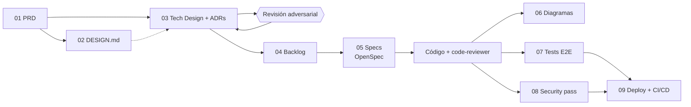

# Documentación — pipeline AI-First

Esta carpeta está ordenada en el mismo orden en que se construyó el proyecto. Cada paso
**consume el documento anterior**: si el PRD cambia, el diseño técnico, el backlog y las specs
tienen que responder a ese cambio.

## Los pasos

| # | Carpeta | Artefacto | Cómo se generó | Consume |
|---|---|---|---|---|
| 01 | [`01-producto/`](01-producto/) | [`PRD.md`](01-producto/PRD.md) | Skill `generar-prd-conversacional` | La idea del producto |
| 02 | [`02-diseno/`](02-diseno/) | [`DESIGN.md`](02-diseno/DESIGN.md) | Stitch → tokens de `tailwind.config.js` | PRD |
| 03 | [`03-arquitectura/`](03-arquitectura/) | [`TECH-DESIGN.md`](03-arquitectura/TECH-DESIGN.md) + [14 ADRs](03-arquitectura/adrs/) + [`REVISION-ADVERSARIAL-v1.md`](03-arquitectura/REVISION-ADVERSARIAL-v1.md) | Skills `generar-tech-design` + `revision-adversarial` (subagente con contexto limpio); v1 conservada en [`TECH-DESIGN-v1.md`](03-arquitectura/TECH-DESIGN-v1.md) | PRD + DESIGN |
| 04 | [`04-backlog/`](04-backlog/) | [`BACKLOG.md`](04-backlog/BACKLOG.md) | Skill `generar-backlog`, 4 specs ordenadas por dependencias | PRD + TECH-DESIGN + ADRs |
| 05 | [`05-specs/`](05-specs/) | [`README.md`](05-specs/README.md) → [`openspec/changes/`](../openspec/changes/) | OpenSpec + subagente `spec-implementer`, un change por spec | Un ítem del BACKLOG |
| 06 | [`06-diagramas/`](06-diagramas/) | [Secuencia de cotización](06-diagramas/cotizacion-secuencia-v1.md) ([HTML](06-diagramas/cotizacion-secuencia-v1.html)), [flujo de admin](06-diagramas/admin-flujo-v1.md) | Skills `mermaid-diagrams` / `archify` sobre el código real | Código |
| 07 | [`07-testing/`](07-testing/) | [`README.md`](07-testing/README.md) → [`tests/`](../tests/) | Skill `playwright-e2e-test` | PRD (criterios de éxito y casos borde) |
| 08 | [`08-seguridad/`](08-seguridad/) | [`SECURITY-REPORT.md`](08-seguridad/SECURITY-REPORT.md) | Skill `security-pass` (solo análisis, con evidencia) | Código + TECH-DESIGN |
| 09 | [`09-deploy/`](09-deploy/) | [`README.md`](09-deploy/README.md) (Deploy Plan) + [`ci-cd.yml`](../.github/workflows/ci-cd.yml) | Skill `deploy-pass` (diseña antes de ejecutar) | Código + tests + SECURITY-REPORT |

En la raíz quedan los archivos que leen las herramientas, no las personas:
[`CLAUDE.md`](../CLAUDE.md) (contexto y reglas para el agente), [`.claude/`](../.claude/)
(subagentes `code-reviewer` y `spec-implementer`, skills y hooks) y [`README.md`](../README.md)
(portada del proyecto).

> `PRD.md`, `TECH-DESIGN.md`, `BACKLOG.md` y `adrs/` en la raíz son las salidas originales de las
> skills; la versión vigente es la de esta carpeta.

## Trazabilidad: un requisito de punta a punta

1. **PRD** — §Alcance: *"Validación del lado servidor de todos los campos (no se confía en el
   cálculo del cliente)"*; caso borde de curva de tallas inválida → el servidor responde 400.
2. **TECH-DESIGN** — [ADR-0007](03-arquitectura/adrs/0007-validacion-server-side-y-calculo-compartido.md):
   un único esquema Zod en `src/lib/cotizador/schema.ts`, usado por el wizard y por la API.
3. **BACKLOG** — spec 2, *"API REST de cotizaciones y catálogo con validación server-side"*
   (ADR-0006, 0007, 0009, 0010).
4. **OpenSpec** — change [`spec-02-api-cotizaciones`](../openspec/changes/spec-02-api-cotizaciones/).
5. **Código** — `api/quotes.ts` valida con el esquema compartido y devuelve errores por campo.
6. **Test E2E** — `tests/cotizador-errores.spec.ts` → *"muestra el error de campo que devuelve la
   API ante un email inválido"* y *"una curva de tallas invertida o vacía invalida el paso 04"*.
7. **Deploy** — el gate `e2e` de [`ci-cd.yml`](../.github/workflows/ci-cd.yml) bloquea el release
   si ese flujo se rompe.
